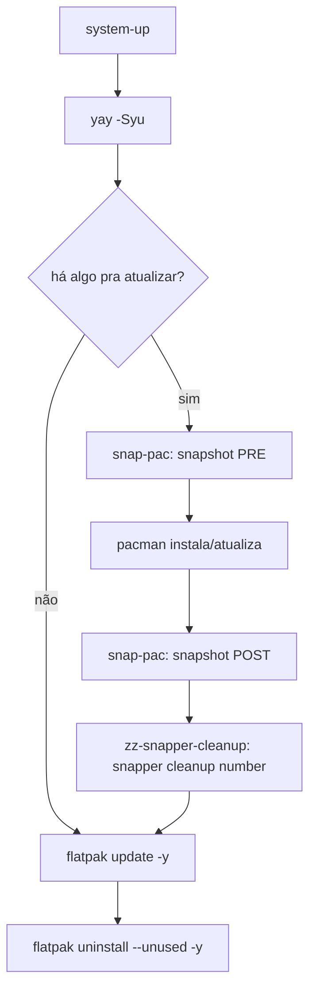

# Atualizações com snapshot automático — snap-pac + snapper + `system-up`

Um comando (`system-up`) atualiza pacman, AUR e Flatpak. Cada transação do pacman é cercada por um snapshot Btrfs pre/post, e o snapper mantém só os 3 mais recentes. Sem criar nem apagar snapshot à mão.

> **Estado atual (2026-11-15):** funcionando. `snap-pac 3.0.1-3` instalado, hook de cleanup em `/etc/pacman.d/hooks/`, `NUMBER_LIMIT=3`, timeline desligado. Isto substitui o fluxo manual descrito na atualização de 2026-10-30 em [`arch-migration.md §1.2`](arch-migration.md).

---

## Visão geral

| Peça | Papel | Onde vive |
|---|---|---|
| `snapper` (config `root`) | cria, lista e limpa snapshots do `/` | `/etc/snapper/configs/root` (não versionado; valores abaixo) |
| `snap-pac` | hook do pacman: snapshot **pre** antes e **post** depois de cada transação | pacote (`packages/pacman.txt`) |
| `zz-snapper-cleanup.hook` | roda `snapper cleanup number` ao fim de cada transação | [`system/etc/pacman.d/hooks/`](../system/etc/pacman.d/hooks/zz-snapper-cleanup.hook) → `/etc/pacman.d/hooks/` |
| `system-up` | alias que encadeia `yay` + `flatpak` | `zsh/.zshrc` |

## Fluxo de um `system-up`



1. `yay -Syu` sincroniza os repositórios e atualiza pacotes oficiais e AUR. O `yay` repassa a instalação ao pacman, e por isso os hooks do pacman disparam normalmente.
2. Se há transação, o snap-pac cria o snapshot **pre**; depois da instalação, o **post**.
3. O hook `zz-snapper-cleanup` roda por último (hooks do pacman executam em ordem alfabética; o prefixo `zz-` garante isso) e apaga o excedente além do limite.
4. `flatpak update -y` atualiza apps e runtimes; `flatpak uninstall --unused -y` remove runtimes órfãos.
5. O `&&` encadeia tudo: se o `yay` falhar, o flatpak não roda.

Sem nada pra atualizar, nenhum snapshot é criado (comportamento esperado do snap-pac).

## Instalação

```bash
cd ~/Projects/dotfiles

# 1. snap-pac
sudo pacman -S --needed snap-pac

# 2. política de retenção (config já existe: snapper -c root create-config /)
sudo snapper -c root set-config \
  NUMBER_CLEANUP=yes NUMBER_MIN_AGE=0 \
  NUMBER_LIMIT=3 NUMBER_LIMIT_IMPORTANT=3 \
  TIMELINE_CREATE=no TIMELINE_CLEANUP=no

# 3. hook de cleanup pós-transação
sudo install -Dm644 system/etc/pacman.d/hooks/zz-snapper-cleanup.hook \
  /etc/pacman.d/hooks/zz-snapper-cleanup.hook
```

O passo 3 também é feito por `bash bootstrap.sh --system` / `--system-only`. O passo 2 **não** está no bootstrap: `set-config` falha numa máquina sem a config `root`, que precisa ser criada antes (ver `arch-migration.md §1.2`).

O alias fica em `zsh/.zshrc`, aplicado pelo `stow zsh`:

```bash
alias system-up='yay -Syu && flatpak update -y && flatpak uninstall --unused -y'
```

## Política de retenção — o que cada chave faz

| Chave | Valor | Efeito |
|---|---|---|
| `NUMBER_CLEANUP` | `yes` | habilita a limpeza por contagem de snapshots |
| `NUMBER_MIN_AGE` | `0` | snapshot pode ser apagado logo, sem idade mínima |
| `NUMBER_LIMIT` | `3` | mantém no máximo 3 itens com limpeza `number` |
| `NUMBER_LIMIT_IMPORTANT` | `3` | limite separado para snapshots `important` |
| `TIMELINE_CREATE` / `TIMELINE_CLEANUP` | `no` | sem snapshots por hora; evitam acúmulo fora do limite |

O timeline continua desligado pelo motivo registrado em `arch-migration.md §1.2`: snapshots acumulados chegaram a prender ~104 GiB.

### Como a contagem funciona

Cada atualização gera um par **pre/post**; o snapper trata o par como uma unidade na limpeza. Estado observado após a instalação:

| # | Tipo | Origem | Limpeza |
|---|---|---|---|
| 960 | single | manual, "antes de atualizar tudo" (02/nov) | `important` |
| 961 | single | criado pela instalação do próprio snap-pac | `number` |
| 962 → 963 | pre/post | `pacman -Syu` | `number` |
| 964 → 965 | pre/post | instalação de `visual-studio-code-bin` | `number` |

Itens `number`: 961 + par 962/963 + par 964/965 = 3, sem exceder o limite, e nada foi apagado. Isso é consistente com cada par valer 1, mas **o cleanup ainda não foi observado apagando algo**. Na próxima atualização real o par novo deve levar a 4 itens e o 961 deve sumir. O 960 não é tocado: `important` nunca entra na limpeza `number`.

## Verificação

```bash
pacman -Q snap-pac
ls /etc/pacman.d/hooks/zz-snapper-cleanup.hook
sudo snapper -c root get-config | grep -E 'NUMBER_(CLEANUP|LIMIT|MIN_AGE)|TIMELINE_(CREATE|CLEANUP)'
sudo snapper -c root list
```

Após uma atualização real, `list` deve mostrar um par pre/post novo e o snapshot `number` mais antigo ausente. Se o excedente continuar lá, o hook não está disparando: confira o caminho do hook e rode `sudo snapper -c root cleanup number` manualmente pra comparar.

Espaço consumido por snapshot (valor "exclusive" é o que cada um realmente prende):

```bash
sudo btrfs filesystem du -s /.snapshots
```

## Recuperação

Reinicie, abra o submenu **"Arch Linux snapshots"** no GRUB (`grub-btrfs`) e escolha o snapshot **pre** da atualização que quebrou. Detalhes do layout flat em [`arch-migration.md §1.2`](arch-migration.md).

## Limites e decisões

- **Flatpak fica fora do snapshot.** Os dados ficam em `/var/lib/flatpak` e o rollback do snapper não reverte atualizações de flatpak de forma confiável. Só pacman e AUR são protegidos.
- **`flatpak ... -y` não pede confirmação.** O `yay` ainda pergunta antes de instalar.
- **A limpeza roda depois da atualização, não antes.** Durante a transação podem existir mais de 3 snapshots; ao fim, ficam 3.
- **Snapshot manual importante continua separado.** Para segurar um ponto de restauração fora da rotação: `sudo snapper -c root create -d "motivo"` (sem `-c`, fica `important` e nunca é apagado sozinho; apague com `snapper delete <id>` quando não precisar mais).
- **Pacotes AUR marcados como "desatualizados"** pelo `yay` (por exemplo `android-apktool`) só indicam que o mantenedor marcou versão nova sem republicar; não é erro.
- **Cobre só a config `root`.** Se criar outra (ex.: `home`), repita o `set-config` e adicione uma linha `Exec` equivalente no hook.
- **Snapshot Btrfs não é backup.** Ver `docs/backup-restic.md`.

## Navegação

- [[docs/arch-migration|Migração Fedora → Arch Linux]] — setup original do snapper e do grub-btrfs
- [[system/README|system/ — configs de /etc versionados]]
- [[docs/backup-restic|Backup off-site com restic]]
